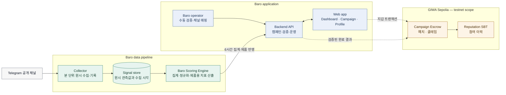

# 01. 제품과 시스템 개요

> **Status:** Current product scope + MVP / Testnet design
> **Last reviewed:** 2026-07-30

Baro는 한국 Web3 Telegram 공개 채널에서 나오는 신호를 모아, 프로젝트·내러티브·채널의 변화를 탐색할 수 있게 만드는 제품이다. 캠페인은 이 정보가 대시보드에서 끝나지 않고, 실제 참여와 보상으로 이어지는지 확인하기 위한 흐름이다.

데이터를 수집하고 해석하는 일, 유저의 퀘스트 완료를 확인하는 일은 Baro 애플리케이션에서 처리한다. 반면 예산 예치, 보상 수령, 참여 이력처럼 나중에 다시 확인해야 하는 사실은 GIWA 호환 EVM 환경에 남긴다. 이 구분 덕분에 원문 메시지나 내부 판단 기준을 체인에 올리지 않으면서도, 보상과 참여 기록은 검증 가능한 형태로 남길 수 있다.

## 지금 제공하는 범위

| 영역 | 상태 | 포함하는 기능 |
|---|---|---|
| **Baro Intelligence** | `Current` | 공개 Telegram 채널 수집, 채널 탐색, 프로젝트 마인드셰어, 트렌드 화면 |
| **Campaign MVP** | `MVP / Testnet` | 캠페인 조회, 지갑 연결, 퀘스트 상태, 보상 클레임, 활동 이력 |
| **Channel operator flow** | `MVP / Testnet` | 운영팀의 채널 매핑·대조, 정산용 지갑 등록 |
| **Attribution and automation** | `Planned` | 고유 링크, 유입 추적, 자동 검증 확대, 셀프서비스 캠페인 등록 |

> **범위 표시 원칙:** `MVP / Testnet`은 설계·구현·검증 대상이라는 뜻이다. 실제 컨트랙트 주소, ABI, 트랜잭션, 테스트 결과가 기록되기 전에는 배포 완료로 표현하지 않는다.

## 시스템을 이루는 요소

| 구성 요소 | 맡는 일 | 저장하거나 전달하는 것 | 남기지 않는 것 |
|---|---|---|---|
| **Telegram 공개 채널** | 공개 메시지와 채널 메타데이터를 제공 | 조회수, 포워드 수, 구독자 수, 게시물 수, 공개 메타데이터 | 비공개 그룹·DM의 데이터 |
| **Collector & data store** | 관측값을 수집하고 채널·게시물 단위로 정리 | 원시 관측값, 수집 시각, 수집 상태 | 개인 지갑의 비밀키 |
| **Baro Scoring Engine** | 집계 기간의 신호를 제품용 지표로 변환 | 영향력 지수, 마인드셰어, 추세 데이터 | 가중치·임계값·예외 규칙 |
| **Baro application** | 탐색, 캠페인 운영, 검증 요청, 운영 로그 | 캠페인 상태, 퀘스트 상태, 검증 결과 | 보상 예치금의 직접 보관 권한 |
| **GIWA contracts** | 예산 예치, 클레임, 참여 이력 기록 | 캠페인 예산 상태, 완료·클레임 상태, SBT/레퓨테이션 데이터 | Telegram 원문, 분석 피처, 개인정보 |
| **User wallet** | 거래 서명과 보상 수령 | 유저가 직접 서명하는 주소와 트랜잭션 | Baro 서버가 보관하는 지갑 비밀키 |

## 데이터와 보상이 연결되는 흐름

아래 그림은 데이터가 들어와 제품에 반영되고, 검증된 참여가 온체인 보상으로 이어지는 경로를 함께 보여 준다. 실선은 현재 기준의 책임 경계를, 점선은 테스트넷 검증이 필요한 온체인 연동을 뜻한다.

## 수집 시점과 제품 반영 시점

원시 관측값을 기록하는 주기와 사용자가 대시보드에서 새 지표를 보는 주기는 같은 개념이 아니다. Collector는 **분 단위 원시 수집**으로 공개 채널의 관측값을 쌓고, Baro Scoring Engine은 일정한 집계 창을 기준으로 제품용 결과를 계산한다. 현재 공개 문서에서는 **6시간을 지표 집계와 제품 반영 주기**로 사용한다.

원시 수집 주기의 정확한 분 단위 값은 배포 환경의 스케줄러 설정이 기준이므로, 코드 또는 운영 설정이 확정된 뒤 이 문서에 함께 기록한다. 근거 없이 6시간을 원시 데이터 수집 주기라고 쓰지 않는다. 수집·집계·표시의 세부 범위는 [데이터 인텔리전스](./02-data-intelligence.md)에서 다룬다.

## 각 구성 요소가 만나는 지점

| From | To | 전달하는 것 | 목적 |
|---|---|---|---|
| Telegram | Collector | 공개 채널·게시물 관측값 | 채널 및 프로젝트 신호 수집 |
| Collector / store | Baro Scoring Engine | 기간·채널 단위로 정리된 관측값 | 집계와 제품용 지표 계산 |
| Scoring Engine | Backend API | 영향력·마인드셰어 결과와 기준 시각 | 화면 노출과 캠페인 맥락 제공 |
| Web app | Backend API | 캠페인·퀘스트·채널 매핑 요청 | 유저와 운영자 동작 처리 |
| Backend API | GIWA contracts | 검증된 완료 결과 또는 서명 | 보상 가능한 상태 만들기 |
| User wallet | GIWA contracts | 클레임 트랜잭션 | 보상 수령과 이력 확인 |

## 아직 확정하지 않은 부분

아래 항목은 설계·운영에서 추가로 결정해야 한다. 이 문서에서는 가정으로 채우지 않고, 결정이 나면 [구현 단계와 결정 기록](./06-delivery-plan-and-decisions.md)에 남긴다.

| 항목 | 현재 상태 |
|---|---|
| 실제 컨트랙트 주소와 배포 트랜잭션 | 배포 증거 기록 전 |
| 완료 권한 모델과 운영자 서명 인프라 | 결정 필요 |
| 어뷰징 방지 규칙과 차단 기준 | 운영 검증 필요 |
| 채널 운영자 정산 정책 | 정책 확정 필요 |
| 고유 링크 기반 유입 어트리뷰션 | 다음 단계 범위 |
| 원시 수집 배치의 정확한 설정값 | 배포 설정 기준으로 기록 예정 |
