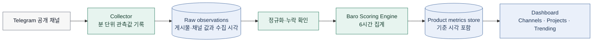
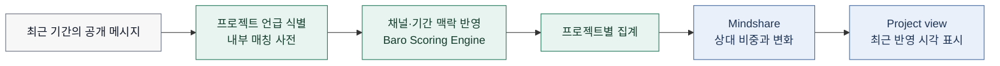

# 02. 데이터 인텔리전스

> **Status:** Current for signal collection and dashboard publication
> **Last reviewed:** 2026-07-30

Baro Intelligence는 한국 Web3 Telegram 공개 채널에서 관측되는 활동을 같은 기준으로 정리한다. 목적은 “어느 채널이 더 좋다”는 주관적 판단을 내리는 것이 아니라, 일정한 기간 안에서 채널의 도달·반응·변화를 비교 가능한 신호로 보여 주는 데 있다.

이 문서에서 설명하는 지표는 투자 판단이나 수익 예측을 위한 것이 아니다. Baro 안에서 프로젝트와 채널을 탐색하고, 대화의 흐름을 읽기 위한 제품 신호로 사용한다.

## Baro가 보는 데이터

Baro는 한국 Web3 관련 **공개 Telegram 채널**을 모니터링 대상으로 삼는다. 비공개 그룹, DM, 접근 권한이 필요한 공간의 대화는 수집·분석 범위에 포함하지 않는다.

| 데이터 범주 | 예시 | 주된 사용처 | 공개 문서에 남기는 수준 |
|---|---|---|---|
| 게시물 관측값 | 조회수, 포워드 수, 게시 시각 | 도달과 반응의 변화 확인 | 데이터 범주와 집계 시점 |
| 채널 관측값 | 구독자 수, 게시물 수, 이름·핸들·설명 | 채널 식별, 규모와 활동성 확인 | 데이터 범주와 갱신 원칙 |
| 파생 지표 | 채널 영향력, 프로젝트 마인드셰어, 추세 | 대시보드 탐색과 비교 | 목적·표시 기준·최종 갱신 시각 |
| 운영 메타데이터 | 수집 성공 여부, 마지막 수집 시각, 누락 상태 | 데이터 품질 확인 | 운영 원칙과 상태 표시 방식 |

원문 메시지 전문, 내부 매칭 사전, 가중치·임계값·예외 규칙은 공개 아키텍처 문서의 대상이 아니다. 이 정보는 제품의 설명에 필요하지 않고, 공개할 경우 지표를 의도적으로 왜곡하려는 행동을 쉽게 만들 수 있다.

## 수집과 대시보드 반영은 다르게 움직인다

원시 관측값을 가져오는 일과, 사용자에게 새 지표를 보여 주는 일은 분리한다. 수집기는 **분 단위 배치**로 공개 채널의 관측값을 기록한다. 그 뒤 Baro Scoring Engine은 누적된 관측값을 기준으로 결과를 계산하고, 대시보드에는 **6시간 주기**로 최종 결과를 반영한다.

| 단계 | 하는 일 | 현재 공개 기준 |
|---|---|---|
| **원시 관측값 기록** | 게시물·채널 값을 수집 시각과 함께 저장 | 분 단위 배치. 정확한 분 단위 설정은 배포 환경 설정을 기준으로 관리 |
| **정규화와 품질 확인** | 중복·누락·형식 차이를 확인하고 기간 단위로 정리 | 내부 처리. 누락 여부와 마지막 성공 시각은 운영에서 확인 |
| **지표 집계** | 채널 영향력과 프로젝트 마인드셰어를 계산 | 6시간마다 제품용 결과 계산 |
| **제품 반영** | 대시보드·채널·프로젝트 화면에 최신 결과를 노출 | 6시간마다 최종 반영. 화면에 기준 시각 표시 권장 |

아래 흐름에서 `raw observations`는 자주 누적되는 기록이고, `6-hour aggregation`은 사용자에게 보일 지표를 확정하는 배치다. 둘을 같은 주기로 설명하지 않는다.

## Baro Scoring Engine

Baro Scoring Engine은 수집된 공개 신호를 제품에서 비교할 수 있는 결과로 정리한다. 엔진은 채널의 도달, 콘텐츠 반응, 최근 변화처럼 서로 다른 성격의 관측값을 함께 보며, 결과는 영향력 지수와 프로젝트 마인드셰어에 사용된다.

이 공개 문서에는 알고리즘의 내부 수식이나 매개변수를 싣지 않는다. 가중치, 상한값, 이상치 처리, 제외 기준, 재계산 규칙은 접근이 통제된 내부 명세와 코드에서 관리한다. 대신 공개 문서에는 지표가 무엇을 위한 것인지, 어떤 데이터 범주를 참고하는지, 언제 갱신되는지를 남긴다.

| 결과 | 사용자가 이해할 수 있어야 하는 것 | 공개하지 않는 것 |
|---|---|---|
| **채널 영향력** | 일정 기간의 공개 활동을 바탕으로 채널을 비교하는 탐색용 신호라는 점 | 계산식, 가중치, 상한·임계값, 예외 규칙 |
| **프로젝트 마인드셰어** | 특정 프로젝트가 공개 채널 대화에서 차지하는 상대적 비중과 변화라는 점 | 프로젝트 매칭 사전, 가중 방식, 필터 규칙 |
| **추세 변화** | 기준 기간 대비 오름·내림과 마지막 반영 시각 | 내부 감지 규칙, 알림 임계값 |

> **표현 원칙:** 높은 점수는 투자 가치, 품질, 공식 파트너십을 뜻하지 않는다. Baro의 지표는 공개 커뮤니티에서 관측되는 대화와 활동을 탐색하기 위한 신호다.

## 프로젝트 마인드셰어가 만들어지는 과정

프로젝트 마인드셰어는 특정 프로젝트가 언급된 공개 대화를 프로젝트 단위로 정리한 결과다. 메시지에서 프로젝트 관련 표현을 식별하고, 채널과 기간의 맥락을 반영한 뒤, 전체 관측량 안에서의 상대적 비중을 제품 화면에 표시한다.

프로젝트명, 티커, 약어는 서로 겹치거나 문맥에 따라 다른 뜻으로 쓰일 수 있다. 매칭 규칙을 바꿀 때는 단순히 새 키워드를 추가하는 데 그치지 않고, 기존 마인드셰어 결과가 어떻게 달라지는지 함께 검토한다.

## 화면에 함께 보여 줄 정보

지표를 숫자만으로 보여 주면 사용자는 기준 시점과 해석 범위를 알기 어렵다. 아래 정보는 결과를 읽는 데 필요한 최소 맥락이므로, 대시보드와 API 응답에서 함께 관리한다.

| 항목 | 화면 또는 API에서 필요한 이유 |
|---|---|
| 기준 기간 | 사용자가 어떤 기간의 신호를 비교하는지 알 수 있다 |
| 마지막 반영 시각 | 아직 새 배치가 반영되지 않았는지 구분할 수 있다 |
| 관측 채널 수 | 결과의 커버리지와 변화 원인을 해석하는 데 도움이 된다 |
| 데이터 상태 | 수집 실패·누락이 있을 때 잘못된 해석을 줄인다 |
| 지표 안내 문구 | 투자 지표가 아니라 탐색용 신호임을 분명히 한다 |

## 데이터 품질을 확인하는 방법

공개 채널 데이터는 수집 시점, 채널 상태, 접근 가능 범위에 따라 달라질 수 있다. 지표가 크게 바뀌었을 때는 먼저 데이터 품질 문제인지, 실제 대화 흐름의 변화인지 구분해야 한다.

| 확인할 상황 | 먼저 볼 것 | 운영상 대응 |
|---|---|---|
| 특정 채널의 값이 갑자기 비어 있음 | 마지막 수집 성공 시각, 채널 접근 상태 | 누락 상태 표시 후 재수집 또는 제외 여부 검토 |
| 순위가 크게 바뀜 | 집계 기준 시각, 데이터 누락, 엔진 변경 여부 | 변경 이력과 배치 로그를 함께 확인 |
| 프로젝트가 잘못 잡힘 | 프로젝트명·티커·문맥 충돌 | 내부 매칭 사전 보완 및 과거 결과 영향 검토 |
| 채널이 비활성화되거나 이름을 바꿈 | 채널 ID와 최신 메타데이터 | 채널 레지스트리 갱신 및 화면 상태 조정 |

## 변경을 남기는 방식

수집·집계·표시 방식이 바뀌면, 사용자에게 보이는 결과가 이전과 바로 비교되지 않을 수 있다. 변경 시에는 최소한 변경일, 영향을 받은 화면 또는 API, 기준 시점, 운영상 이유를 남긴다. 내부 알고리즘의 상세 값을 공개하지 않아도, 결과가 달라진 이유를 설명할 수 있어야 한다.
