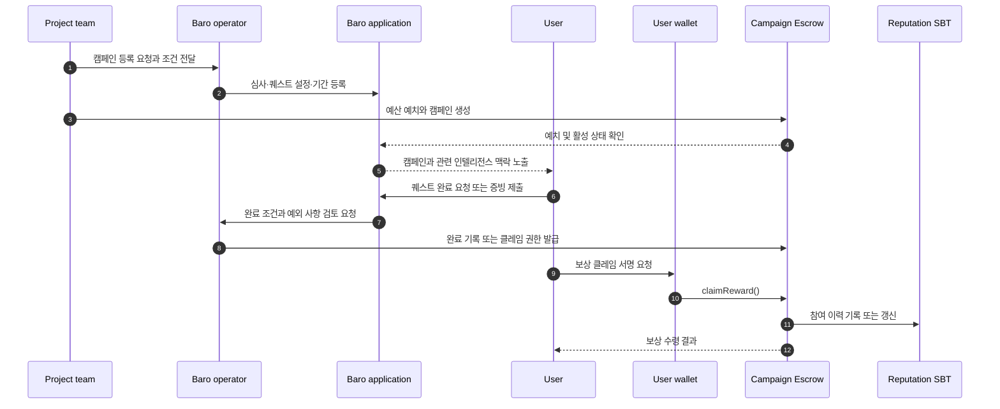
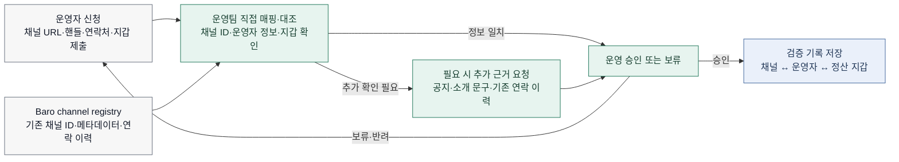
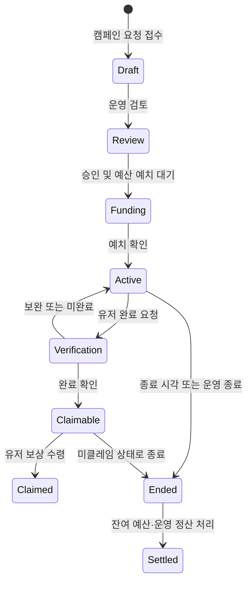

# 03. 캠페인과 검증 흐름

> **Status:** MVP / Testnet design
> **Last reviewed:** 2026-07-30

캠페인 모듈은 Baro Intelligence에서 확인한 한국 커뮤니티의 맥락을 실제 참여로 연결하기 위한 기능이다. 프로젝트는 보상 예산을 준비하고, 유저는 퀘스트를 수행하며, Baro는 완료 조건을 확인한다. 검증된 참여만 보상 클레임과 온체인 이력으로 이어지는 것이 기본 원칙이다.

초기에는 프로젝트 등록, 예외 처리, 일부 퀘스트 검증을 운영자가 직접 맡는다. 자동화를 미루기 위한 선택이 아니라, 검증 규칙과 어뷰징 대응이 충분히 검증되기 전 잘못된 보상이 대량으로 발생하는 일을 막기 위한 운영 범위다.

## 누가 무엇을 확인하는가

| 참여자 | 맡는 일 | 맡지 않는 일 |
|---|---|---|
| 프로젝트 팀 | 캠페인 요청, 보상 예산 준비, 캠페인 정보 제공 | Baro의 검증 결과를 임의로 바꾸는 일 |
| Baro 운영팀 | 캠페인 심사, 퀘스트 설정, 완료 검증, 채널 매핑·대조 | 유저 지갑의 비밀키 보관 |
| 유저 | 캠페인 탐색, 퀘스트 수행, 보상 클레임 | 운영자 확인 없이 완료 상태를 직접 바꾸는 일 |
| 채널 운영자 | 채널·연락처·정산 지갑 정보를 제공하고 필요한 근거를 확인 | 자동화된 유입 성과 정산을 받는 일 |
| GIWA contracts | 예치 상태, 완료·클레임 상태, 참여 이력 기록 | Telegram 원문이나 내부 판단 기준 저장 |

## 한 캠페인이 끝까지 가는 과정

아래 흐름은 한 캠페인이 등록부터 보상 수령까지 이어지는 최소 경로다. 테스트넷에서는 이 흐름을 먼저 닫아 보고, 자동화는 운영 비용과 오류 패턴을 확인한 뒤 넓힌다.

## 캠페인을 열기 전에 정하는 것

프로젝트의 캠페인 등록은 초기에는 수동 접수로 시작한다. 운영팀은 아래 내용을 확인하고, 누락된 조건이 있으면 캠페인을 공개하지 않는다.

| 확인 항목 | 확인하는 이유 |
|---|---|
| 프로젝트 정보와 공식 연락처 | 캠페인 요청 주체를 확인한다 |
| 보상 토큰·총예산·보상 단위 | 예산 부족과 지급 기준 혼선을 줄인다 |
| 시작·종료 시각 | 참여 가능 기간과 종료 후 정산 기준을 맞춘다 |
| 퀘스트 조건과 완료 근거 | 운영자·유저가 같은 완료 기준을 보게 한다 |
| 예외 처리와 보류 기준 | 어뷰징·오류 상황에서 임의 판단을 줄인다 |
| 예치 거래 또는 테스트넷 자금 상태 | 활성화 전에 실제 지급 가능 여부를 확인한다 |

캠페인 상세 화면에는 퀘스트 목록, 보상 규모, 남은 기간, 참여 상태와 함께 해당 프로젝트의 Baro Intelligence 맥락을 보여 주는 것을 목표로 한다. 캠페인 탐색 자체는 지갑 연결 이전에도 가능하게 두고, 보상을 받는 시점에만 지갑 연결을 요청한다.

## 퀘스트 완료를 확인하는 방식

모든 활동을 같은 방식으로 확인할 수는 없다. 초기에는 완료 근거가 명확한 활동부터 운영하고, 예외가 많거나 조작 가능성이 큰 활동은 수동 검증으로 남긴다.

| 검증 방식 | 초기 적용 | 설명 |
|---|---|---|
| 운영팀 수동 확인 | `MVP baseline` | 증빙, 예외, 어뷰징 의심 건을 운영자가 검토한다 |
| Telegram Bot 기반 확인 | `Scope review` | 정의된 채널 활동을 확인할 수 있는지 별도로 검증한다 |
| 외부 API 기반 확인 | `Planned` | X 등 외부 조건을 자동 확인하는 방식 |
| 온체인 이벤트 확인 | `Planned` | 정의된 계약 이벤트를 완료 근거로 반영하는 방식 |

> **운영 원칙:** 자동으로 확인할 수 있는 활동이더라도, 검증 실패·중복 참여·의심 활동의 예외 처리 경로는 항상 운영팀에 남긴다.

## 채널 운영자는 직접 매핑하고 대조한다

채널 운영자 확인은 초기에는 자동 인증 코드 발급이나 Bot 확인을 전제로 하지 않는다. 운영팀이 이미 관리하는 채널 레지스트리와 신청 정보를 직접 대조하고, 필요할 때만 추가 근거를 요청하는 방식으로 운영한다.

이 흐름은 완전 자동화보다 느릴 수 있지만, 채널명 변경·유사 핸들·대행 운영·정산 지갑 변경처럼 실제 운영에서 자주 생기는 예외를 더 안전하게 처리할 수 있다. 특히 금전 정산과 연결되는 단계에서는 사람이 최종 확인하는 편이 초기 제품에 더 적합하다.

| 대조 항목 | 확인 목적 | 처리 원칙 |
|---|---|---|
| 채널 URL·핸들·채널 ID | 같은 이름의 다른 채널을 구분 | 표시명보다 채널 식별자를 우선한다 |
| 기존 레지스트리 정보 | Baro가 이미 추적 중인 대상인지 확인 | 메타데이터 변경 이력을 함께 본다 |
| 운영자 연락처 또는 기존 대화 이력 | 신청 주체와 채널 관리 주체의 연결을 확인 | 공개하지 않는 운영 정보로 보관한다 |
| 정산 지갑 | 보상·정산 수령 대상을 확인 | 변경 요청은 별도 재검토한다 |
| 필요 시 추가 근거 | 일치하지 않는 정보를 해소 | 채널 공지·소개 문구 변경 등 최소 근거만 요청한다 |

고유 링크 기반 유입 추적과 채널별 전환 성과 자동 집계는 현재 범위에 넣지 않는다. 이 기능은 별도의 데이터 모델, 프라이버시 검토, 어뷰징 대응이 필요하므로 다음 단계에서 다룬다.

## 완료 상태는 한 번만 바뀐다

현재 설계에는 완료 사실을 체인에 반영하는 방식이 두 가지로 남아 있다. 운영자가 직접 완료를 기록하는 방식과, 백엔드가 EIP-712 서명을 발급해 유저가 클레임 때 제출하는 방식이다. 둘을 한 배포에서 애매하게 섞으면 감사·테스트·운영이 어려워지므로, 구현 PR에서 하나를 선택하고 인터페이스·프론트엔드·운영 절차를 함께 고정한다.

| 방식 | 계약이 확인하는 것 | 운영상 특징 |
|---|---|---|
| 운영자 직접 기록 | 운영자 권한으로 완료 상태 변경 | 흐름이 단순하지만 운영자 트랜잭션이 필요하다 |
| EIP-712 서명 | 유저가 제시한 서명의 발급자·도메인·nonce·만료 | 유저 주도 클레임이 가능하지만 서명 보안 설계가 필요하다 |

## 화면과 운영에서 쓰는 상태

아래 상태는 UI와 운영에서 사용할 최소 상태 모델이다. 실제 컨트랙트의 enum·함수명은 ABI가 확정되면 코드 기준으로 교체한다.

## 운영에서 놓치지 않을 것

캠페인 시작 전에는 예산·기간·퀘스트 조건을 기록하고, 운영 중에는 수동 검증 기준과 예외 처리 기준을 같은 운영 문서에서 관리한다. 클레임 전에는 중복 완료·중복 보상·잔여 예산을 확인한다. 종료 후에는 미클레임 잔액 처리, 채널 운영자 정산, 운영 로그 보관 절차를 확인한다.

기능을 넓히기 전에는 자동 검증과 고유 링크 추적이 실제로 운영 비용을 줄이는지, 새 어뷰징 경로를 만들지 않는지 먼저 검토한다.
