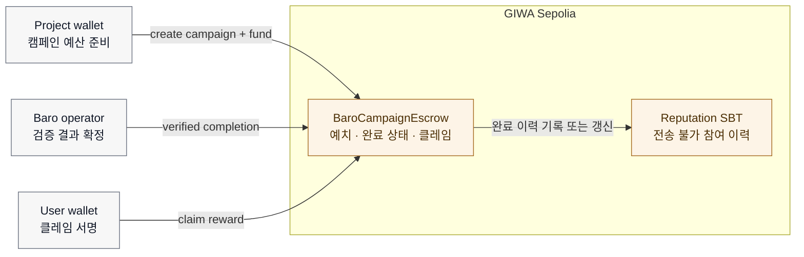
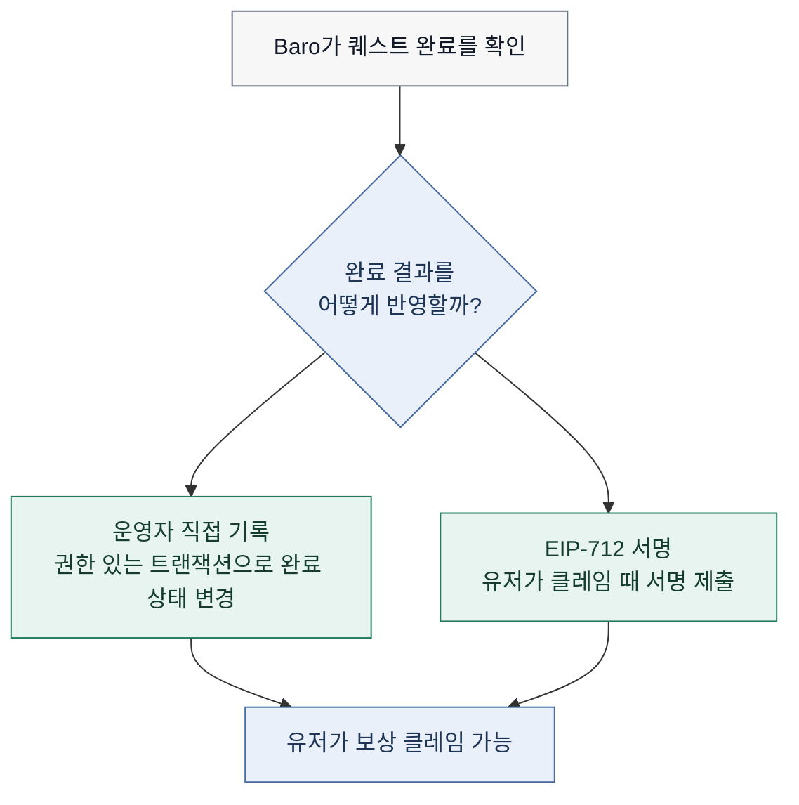

# 04. GIWA 온체인 모듈

> **Status:** MVP / Testnet design — deployment evidence is recorded separately
> **Last reviewed:** 2026-07-30

Baro의 온체인 모듈은 두 가지를 맡는다. 첫째, 프로젝트가 준비한 보상 예산을 캠페인 단위로 예치하고 검증된 유저가 직접 수령할 수 있게 한다. 둘째, 퀘스트 완료와 채널 운영자 확인처럼 나중에 다시 확인할 가치가 있는 참여 이력을 전송 불가 레퓨테이션 기록으로 남긴다.

Telegram 데이터 수집과 마인드셰어 계산은 체인 밖에서 수행한다. 체인에는 원문 메시지, Baro Scoring Engine의 내부 규칙, 개인식별정보를 넣지 않는다. 필요한 참여·보상·이력 사실만 검증 가능하게 남기는 것이 이 모듈의 기준이다.

## 테스트넷 연결 정보

아래 값은 테스트넷 개발·검증에 쓰는 기준값이다. 프론트엔드 설정이나 배포 작업을 바꾸기 전에는 실제 RPC 응답과 배포 환경 설정으로 다시 확인한다.

| 항목 | 기준값 |
|---|---|
| 네트워크 | GIWA Sepolia |
| Chain ID | `91342` (`0x164CE`) |
| Native currency | ETH |
| RPC | `https://sepolia-rpc.giwa.io/` |
| Flashblocks RPC | `https://sepolia-rpc-flashblocks.giwa.io/` |
| Explorer | `https://sepolia-explorer.giwa.io/` |
| 호환성 | OP Stack 기반 EVM 호환 테스트넷 |

> **표기 주의:** 네트워크 설정에서는 10진수 체인 ID `91342`를 기준으로 사용한다. 16진수 표기는 `0x164CE`다.

## 체인에 남기는 것과 남기지 않는 것

| 구분 | 체인에 남기는 정보 | 체인에 남기지 않는 정보 |
|---|---|---|
| 캠페인 예산 | 보상 토큰, 예치 상태, 캠페인 식별자, 잔여 예산 | 프로젝트의 내부 마케팅 자료 |
| 퀘스트 완료 | 완료·클레임 여부, 필요한 최소 식별자 | 증빙 원문, 운영자 검토 메모 |
| 참여 이력 | SBT 또는 레퓨테이션 상태 | Telegram 메시지, 채널 분석 피처 |
| 채널 운영자 확인 | 필요 시 확인 상태와 최소 참조값 | 운영자 연락처, 수동 매핑 근거 전문 |

## Campaign Escrow가 맡는 일

`BaroCampaignEscrow`는 프로젝트가 지급할 보상 예산을 캠페인 시작 전에 예치하고, 한 번 검증된 퀘스트가 중복 지급되지 않도록 상태를 관리하는 모듈이다. ETH와 ERC-20 보상 토큰을 모두 고려하되, 실제 지원 토큰 범위는 배포 전 ABI와 테스트 결과로 확정한다.

| 기능 | 의도 | 검토해야 할 조건 |
|---|---|---|
| `createCampaign()` | 캠페인 조건과 예산을 등록 | 예치액, 시작·종료 시각, 보상 토큰, 보상 단위 |
| 완료 기록 또는 완료 권한 발급 | 오프체인 검증 결과를 클레임 가능한 상태로 연결 | 중복 완료 방지, 권한 검증, 만료 처리 |
| `claimReward()` | 유저가 본인 지갑으로 보상을 수령 | 완료 여부, 미클레임 여부, 잔여 예산 |
| `withdrawRemainingBudget()` | 종료 후 미사용 예산을 프로젝트에 반환 | 종료 시각, 캠페인 비활성화, 권한 확인 |

## 완료 결과를 체인에 반영하는 두 선택지

현재 설계에는 운영자가 완료 상태를 직접 기록하는 방식과, 백엔드가 EIP-712 서명을 발급하고 유저가 클레임 때 제출하는 방식이 함께 있다. 둘 모두 가능한 설계지만, 배포 단위에서는 하나를 명확하게 선택해야 한다.

| 방식 | 계약이 확인하는 것 | 운영상 특징 |
|---|---|---|
| 운영자 직접 기록 | `onlyOperator` 권한으로 완료 상태 변경 | 흐름이 단순하지만 운영자 트랜잭션과 키 관리가 필요하다 |
| EIP-712 서명 | 유저가 제시한 서명의 발급자·도메인·nonce·만료 | 유저 주도 클레임이 가능하지만 서명 보안 설계가 필요하다 |

선택이 끝나면 컨트랙트 인터페이스, 프론트엔드 호출 방식, 운영 절차, 테스트 케이스를 같은 PR에서 함께 바꾼다. 상세 비교는 [캠페인과 검증 흐름](./03-campaign-and-verification.md)에도 남긴다.

## Reputation SBT

Reputation SBT는 유저 또는 채널 운영자의 활동 이력을 나타내는 전송 불가 토큰 또는 레코드다. 첫 퀘스트 완료나 채널 운영자 확인을 계기로 최초 발급하고, 이후 참여 이력을 갱신하는 구조를 검토한다.

| 기록 후보 | 제품에서 쓰는 이유 | 온체인 처리 상태 |
|---|---|---|
| 퀘스트 완료 수 또는 포인트 | 반복 참여 이력을 보여 준다 | 정책 확정 필요 |
| 참여 캠페인 수 | 참여 폭을 보여 준다 | 선택 사항 |
| 채널 운영자 확인 상태 | 채널 제어권 대조 결과를 표시한다 | 정책 확정 필요 |
| 마지막 갱신 시각 | 상태의 최신성을 보여 준다 | 기록 후보 |

### 레퓨테이션 표시명

제품에서 쓰는 표시명은 아래 다섯 단계로 정리한다. 정확한 승급 조건과 혜택은 아직 고정하지 않았으므로, 이 문서에 수치나 보상 가산을 사실처럼 적지 않는다.

| 레벨 | 표시명 | 조건·혜택 |
|---:|---|---|
| 1 | 신입 | 정책 확정 전 |
| 2 | 수련자 | 정책 확정 전 |
| 3 | 마스터 | 정책 확정 전 |
| 4 | 그랜드 마스터 | 정책 확정 전 |
| 5 | 챔피언 | 정책 확정 전 |

레벨 정책을 정할 때는 점수의 원천, 단계별 조건, 비정상 활동 제외 규칙, 단계별 혜택, 온체인·오프체인 책임, 정책 변경 시 기존 유저에 적용하는 방식을 하나의 버전으로 고정한다.

## 지갑 경험

프론트엔드는 EVM 지갑에서 GIWA Sepolia로 전환하고, 보상 클레임 트랜잭션을 보낼 수 있게 설계한다. 유저에게는 아래 원칙을 유지한다.

1. 캠페인 탐색에는 지갑 연결을 강제하지 않는다.
2. 보상을 받는 시점에만 지갑 연결과 네트워크 전환을 요청한다.
3. 서명 요청과 온체인 트랜잭션을 구분해 보여 준다.
4. 트랜잭션 해시와 Explorer 링크를 결과 화면에 남긴다.

## 배포 전에 확인할 것

`Ownable`, `ReentrancyGuard`, ERC-20 인터페이스 사용은 좋은 출발점이지만, 보안 감사 완료를 의미하지 않는다. 실제 가치가 있는 자산을 다루기 전에는 권한 분리, 중복 지급 방지, nonce·만료·도메인 분리, 비표준 ERC-20 처리, 종료 후 잔여 예산 회수, 운영 키의 교체·사고 대응을 테스트와 운영 절차로 확인한다.

## 배포 레지스트리

컨트랙트가 실제로 배포된 뒤 아래 표를 채운다. 주소가 없을 때 `TBD`라고 쓰기보다 빈칸을 유지해 배포 완료로 오해되지 않게 한다.

| 네트워크 | 모듈 | 주소 | 배포 트랜잭션 | 구현 커밋 | 검증 상태 |
|---|---|---|---|---|---|
| GIWA Sepolia | `BaroCampaignEscrow` |  |  |  | 미기록 |
| GIWA Sepolia | `Reputation SBT` |  |  |  | 미기록 |
