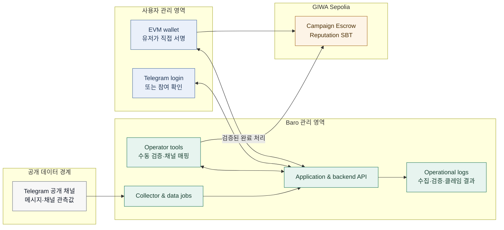

# 05. 데이터·보안·운영 경계

> **Status:** Baseline policy and implementation checklist
> **Last reviewed:** 2026-07-30

Baro는 Telegram의 공개 신호를 제품 데이터로 사용하고, 퀘스트 참여를 지갑 기반 보상으로 연결한다. 따라서 데이터가 어디에서 생성되고, 누가 접근하며, 어떤 값만 체인에 남는지를 분명히 하는 일은 기능 설명만큼 중요하다.

이 문서는 아직 구현되지 않은 통제를 구현 완료처럼 보이게 하지 않는다. `Current`는 현재 제품·운영 기준에 포함된 범위이고, `Required before production`은 실제 자산이나 개인 데이터의 범위가 커지기 전에 구현·검토해야 하는 범위다.

## 데이터가 지나가는 경계

## 어디에 어떤 데이터를 둔다

| 데이터 유형 | 예시 | 처리 위치 | 온체인 기록 | 상태 |
|---|---|---|---|---|
| 공개 채널 메타데이터 | 채널명, 핸들, 설명, 채널 ID | Intelligence 데이터 저장소 | 기록하지 않음 | `Current` |
| 공개 활동 관측값 | 조회수, 포워드 수, 구독자 수, 게시물 수 | Intelligence 데이터 저장소 | 기록하지 않음 | `Current` |
| 파생 지표 | 채널 영향력, 프로젝트 마인드셰어, 추세 | Intelligence 데이터 저장소 | 기본적으로 기록하지 않음 | `Current` |
| 유저 계정 연결 | Telegram 식별자와 지갑 주소의 연결 | Application 데이터 저장소 | 계약 호출에는 지갑 주소만 사용 | `MVP / Testnet` |
| 퀘스트 검증 결과 | 완료 여부, 완료 시각, 근거 요약 | Application·운영 로그 | 완료·클레임 상태만 | `MVP / Testnet` |
| 채널 운영자 매핑 | 채널 ID, 운영자 연락 창구, 정산 지갑, 확인 시각 | 제한된 운영 저장소 | 필요 시 확인 상태만 검토 | `MVP / Testnet` |
| 보상·참여 이력 | 캠페인 ID, 퀘스트 ID, 클레임 상태 | GIWA contract | 기록 | `MVP / Testnet` |
| 내부 비밀 | API 키, 운영자 키, DB 자격증명 | 비밀 관리 환경 | 절대 기록하지 않음 | `Required before production` |

원문 메시지 전문, 개인식별정보, Baro Scoring Engine의 상세 규칙은 체인에 남기지 않는다. 온체인에는 검증에 필요한 최소 참여·보상·이력 정보만 기록한다는 원칙을 유지한다.

## 권한은 역할별로 나눈다

| 역할 | 필요한 권한 | 제한해야 할 권한 | 프로덕션 전 확인 |
|---|---|---|---|
| 서비스 백엔드 | 데이터 처리, 캠페인 상태 조회, 검증 요청 처리 | 사용자 개인키 접근 | 예 |
| Baro 운영팀 | 캠페인 심사, 수동 검증, 채널 매핑, 예외 처리 | 독단적 자금 이동 또는 무기한 권한 | 예 |
| 프로젝트 소유자 | 본인 캠페인의 예산 예치·종료 후 잔액 회수 | 타 프로젝트 수정, 타 유저 완료 상태 변경 | 예 |
| 유저 | 본인 지갑으로 보상 클레임 | 타 유저 정보·보상 요청 | 예 |
| 채널 운영자 | 본인 채널 관련 정보와 정산 지갑 제공 | 타 채널의 매핑·정산 정보 열람 | 예 |

실제 컨트랙트는 owner, operator, escrow 사이에서 어떤 권한을 나누는지 명확히 해야 한다. 운영 속도가 빠르다는 이유로 하나의 키에 예치·검증·출금 권한을 모두 몰아두지 않는다.

## 운영자 키와 서명

퀘스트 완료를 운영자 트랜잭션이나 EIP-712 서명으로 처리한다면, 운영자 키는 가장 중요한 신뢰 경계가 된다. 아래 기준은 구현 방식을 선택하기 전에도 운영 문서에 남겨 둔다.

| 항목 | 최소 기준 |
|---|---|
| 키 보관 | 로컬 파일·문서·채팅에 저장하지 않고, 접근 통제된 비밀 관리 환경을 사용한다 |
| 접근자 | 키를 사용할 수 있는 사람과 승인 절차를 기록한다 |
| 키 교체 | 교체 사유, 이전 키 폐기, 계약 권한 변경 절차를 준비한다 |
| 서명 범위 | chain ID, 계약 주소, 캠페인·퀘스트·지갑 주소, nonce, 만료를 묶어 재사용을 막는다 |
| 로그 | 서명 또는 완료 처리의 요청자·시각·결과를 감사 가능한 형태로 남긴다 |
| 사고 대응 | 키 노출·오발급·비정상 클레임 발생 시 중지와 재개 절차를 마련한다 |

## 사람이 확인한 사실도 기록으로 남긴다

수동 검증과 채널 매핑은 단순한 메신저 대화로 끝나면 나중에 재현하기 어렵다. 운영 로그는 사용자를 과도하게 추적하기 위한 것이 아니라, 데이터 오류·보상 오류·권한 변경을 다시 확인할 수 있게 하기 위해 남긴다.

| 이벤트 | 남길 값 | 쓰는 이유 |
|---|---|---|
| 수집 배치 | 시작·종료 시각, 대상 채널 수, 성공·실패 수 | 데이터 최신성과 누락을 확인한다 |
| 지표 집계 | 제품 반영 시각, 기준 기간, 실행 결과 | 지표·순위 변화의 이유를 설명한다 |
| 캠페인 생성 | 캠페인 ID, 프로젝트 주소, 예산, 기간, 생성 결과 | 예치와 활성 상태를 확인한다 |
| 퀘스트 검증 | 캠페인/퀘스트 ID, 처리 주체, 결과, 예외 사유 | 수동 검증을 재현한다 |
| 보상 클레임 | 유저 주소, 트랜잭션 해시, 결과 | 중복 지급·실패 대응에 쓴다 |
| 채널 운영자 매핑 | 채널 ID, 대조한 정보 유형, 처리 시각, 상태 | 채널·운영자·정산 지갑의 연결을 재확인한다 |

운영 로그의 보관 기간, 접근 권한, 삭제 절차는 운영 환경이 정해지면 별도 정책으로 확정한다. 개인정보가 포함될 수 있는 로그는 필요한 최소 항목만 남긴다.

## 어뷰징은 단계적으로 다룬다

캠페인 보상에는 다중 계정, 자동화된 참여, 허위 증빙 같은 위험이 있다. 초기에는 운영팀의 수동 심사와 보류 기준을 기본으로 두고, 충분한 사례가 쌓인 뒤에 자동 탐지를 추가한다.

| 단계 | 접근 방식 | 현재 위치 |
|---|---|---|
| MVP | 수동 심사, 예외 보류, 중복 클레임 방지 | 범위 정의됨 |
| 다음 단계 | Telegram·지갑·행동 신호를 조합한 자동 탐지 | 상세 설계 필요 |
| 운영 성숙 단계 | 규칙 변경 이력, 이의 제기, 제재·복구 절차 | 정책 필요 |

## 실제 자산을 다루기 전에

- [ ] 데이터 저장 위치와 백업·복구 절차를 확인한다.
- [ ] API 키와 운영자 키를 어떤 비밀 관리 환경에서 다룰지 확정한다.
- [ ] Telegram 로그인 데이터와 지갑 주소의 보관 범위·삭제 요청 절차를 정의한다.
- [ ] 컨트랙트 권한, 중복 클레임, 잔여 예산 회수에 대한 테스트를 작성한다.
- [ ] EIP-712을 사용할 경우 nonce·만료·도메인 분리 테스트를 작성한다.
- [ ] 어뷰징 의심 건의 보류·승인·거절 절차를 문서화한다.
- [ ] 사고 대응 담당자, 연락 경로, 캠페인 중지 절차를 지정한다.
- [ ] 실제 가치가 있는 자산을 다루기 전 독립 보안 리뷰 범위를 확정한다.
